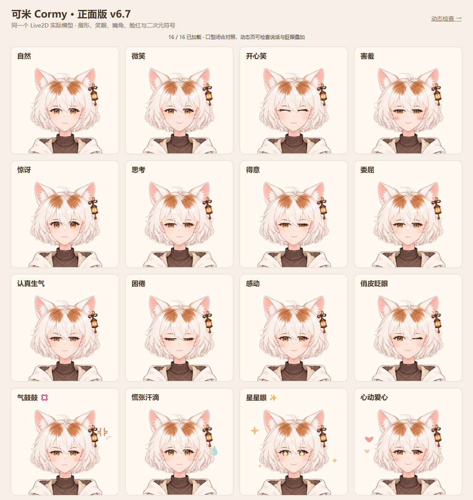

# 可米 Cormy · Live2D 正面版 v6.7

橘白猫主题的可米 Live2D 模型。本版关闭左右转头，沿用 v6.4 的正脸绘制、眼距和耳灯连接。



## 下载与安装

在 [Releases](https://github.com/jcs130/cormy-live2d/releases/latest) 下载 `Cormy-Live2D-v6.7-NoTurn-VTubeStudio.zip`。

1. 解压，将整个 `Cormy-NoTurn-v6.7` 文件夹放入 VTube Studio 的 `VTube Studio_Data/StreamingAssets/Live2DModels/`。
2. 在 VTube Studio 的模型列表中选择 **Cormy NoTurn**。包内附有模型图标。
3. 在模型热键中使用表情和动作；“恢复自然”用于清除表情。默认待机睁眼，眨眼会短暂闭眼。

这是单独的模型 ID，可与之前版本并存。已有模型的个人快捷键、位置和摄像头设置不会被这个安装包覆盖。

## 保留的表现

- 16 个表情：自然、微笑、开心笑、害羞、惊讶、思考、得意、委屈、生气、困倦、感动、眨眼、气鼓鼓、慌张、星星眼、爱心。
- 6 个动作：招手、双手欢呼、害羞收手、轻摆腿、耳朵轻抖、气鼓鼓。
- 自然眨眼、注视与口型；表情不占用眨眼和口型输入。
- 小幅歪头、点头、身体动作、头发与橘白尾巴的物理摆动。

`ParamAngleX` 保留兼容入口，但左右关键形使用同一正面几何，耳朵透明度也固定为正面值。VTS 的左右转头映射、待机中的左右转头曲线及对应物理输入均已关闭。歪头和点头仍可使用；本版没有三维侧脸或侧身。

## 源文件包与集成

- `VTubeStudio/Cormy/`：同一发布的运行模型、2048 贴图、图标、表情、动作、VTS 配置及 `cortico.profile.json`。
- `source/Cormy.psd`：分层原稿；`source/layers.json`：图层坐标。
- `model/Cormy.cmo3`：可编辑 Cubism 工程；导出限制见下方。
- `scripts/BuildCormy.java`：实际生成与绑定入口；`source/runtime-inputs/`：自定义运行配置和动作的重建输入。
- `validation/`：这一版实际运行文件的检查结果；`manifest.json`：SHA-256 清单。

Cortico / VTuber 扩展可导入包内 profile。它的模型名是 `Cormy NoTurn`，左右转头输入归零；情绪映射、特效和动作映射随包提供。接入后的真实直播、摄像头和麦克风需要在目标环境另外验收。

## 重建

需要 Java 21、Python 3、PSD2Live 3.2.0 的 Windows portable `app` 目录。下载及 SHA-256 固定信息见 `engine-pin.json`。制作脚本使用原稿生成，不需要重跑图像生成或重新移动五官。

```powershell
./scripts/rebuild.ps1 -Psd2LiveApp '<PSD2Live 3.2.0>/app'
```

如需执行原生模型检查，额外准备自己获准使用的 Cubism Core Web 运行库和 Node.js：

```powershell
./scripts/rebuild.ps1 -Psd2LiveApp '<PSD2Live 3.2.0>/app' -CubismCoreJs '<Cubism Core>/live2dcubismcore.min.js'
```

本仓库不分发 Cubism Core、VTube Studio、PSD2Live 的可执行程序或个人摄像头配置。

## 本版验证与边界

使用真实 Cubism Core 5.1 和实际 WebGL 渲染验证同一 MOC：

- 相对 v6.4，正面顶点变化为 0；分层 PSD 与贴图保持一致。
- 2,592 组转头 × 表情 × 张嘴 × 眨眼 × 俯仰组合：左右输入不改变有效几何、透明度及绘制顺序。
- 16 表情、288 组眨眼/口型组合、256 组表情切换正常。
- 6 个原生动作实际播放，完成后回到站姿，眨眼与口型不受影响。
- 实际待机检查覆盖自然睁眼、短暂眨眼、困倦表情复位及残留输入清理。

这次验证不包含真实摄像头、麦克风、直播观众端或自动切换 VTS 现役模型。源工程 CMO3 的部分眼部四轴关键形由导出器近似为三轴，动作时间轴单独保存在 motion3 文件；继续制作时以 PSD、绑定脚本与已检查的 MOC 为依据，详见 `validation/cmo3-export.json`。

## 来源与许可

角色设计以作者家的橘白猫为灵感，沿用可米的既有原创设计。本次仅发布模型及制作资料；角色、美术与模型素材没有另外变更或声明开放授权，使用范围请向仓库维护者确认。

制作脚本按 GPL-3.0 发布，见 `COPYING`。生成工具为 [PSD2Live](https://github.com/tsunehimatoi/psd2live)，运行验证使用 [Live2D Cubism](https://www.live2d.com/sdk/download/web/)，各自遵循原项目许可。本仓库不包含其他项目的角色素材、私人猫照片或厂商运行库。
